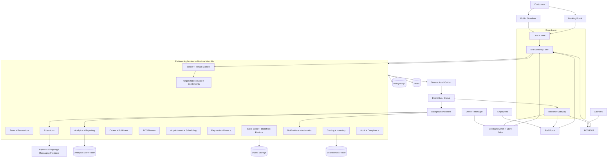

# BillionBiz System Architecture

**Status:** Target architecture proposal. The implementation agent must audit the current repository before deciding what to retain or replace.

## 1. Executive design

Build one multi-tenant platform with shared identity, organization/store, team, customer, catalogue, order, payment, notification and audit foundations. Expose distinct interfaces for Merchant Admin/Store Editor, public Storefront, POS, Appointment Booking and Staff Portal. The interfaces share domain contracts and backend capabilities; they are not separate products with duplicated data models.

Use a **modular monolith** initially. Each domain has explicit ownership, application services, commands/queries, persistence rules and events. Deploy the API and background workers as separate runtime processes from the same codebase if helpful. Extract a domain into a service only after measured scaling, deployment-isolation or team-ownership needs justify the distributed-systems cost.

## 2. Context and container diagram

## 2.1 Store capability composition and Storefront Mode

Keep three layers separate:

1. **Entitlements** answer whether the plan/account may use a module.
2. **Store capabilities** answer which backend modules are enabled for this store (`productCommerce`, `appointments`, optional vertical capabilities such as restaurant POS).
3. **Storefront Mode** is the merchant-facing navigation/entry-point preset: `Commerce`, `Services` or `Both`. The home page (`Landing` or `Booking`) is a separate setting.

This directly follows the current BillionBiz Storefront Mode vocabulary. Do not invent extra initial modes or fork the application into separate store types. The mode preset may set links and cart/wishlist affordances, but backend route/API guards must enforce the capability. In particular, Services mode must block new product checkout operations even through direct `/checkout` URLs or APIs, while retaining authorized access to historical orders.

A mixed product-and-appointment cart is intentionally not an MVP requirement: the two purchase journeys have different fulfillment, reservation and cancellation rules. They share customer, payment, invoices, reporting and identity foundations.

## 3. Applications and responsibilities

| Application | Responsibility | Must not own |
|---|---|---|
| Public Marketing | Landing page, product education, Start free and Log in | Private tenant data |
| Identity Entry | Signup, login, verification, recovery, MFA and workspace routing | Merchant business operations |
| Merchant Admin | Dashboard, orders, catalog, appointments, team, settings, extensions | Independent payment or customer truth |
| Store Editor | Existing visual page builder, themes, templates, drafts, preview, publishing | Separate store identity or catalog |
| Storefront Runtime | Render immutable published store releases and customer journeys | Merchant draft mutation |
| POS PWA | Counter login, fast billing, register, offline queue, receipt | Authoritative inventory/payment status while offline |
| Booking Portal | Customer service discovery, availability, booking and manage booking | Authoritative availability decisions in browser |
| Staff Portal | Personal schedule, assigned bookings, tasks and permitted actions | Organization-wide permissions bypass |
| Customer Account | Store-scoped orders, bookings, receipts, profile and permitted self-service | Merchant/admin records or another customer data |
| Platform Operations Console | Internal tenant/platform health and controlled support workflows | Implicit merchant impersonation or unscoped data access |
| API | Authentication, tenant context, domain commands/queries | Client-trusted amounts or status changes |
| Workers | Notifications, imports, webhooks, shipping operations, scheduled jobs | Untracked side effects without durable job records |

## 4. Bounded contexts and ownership

| Context | Owns | Publishes events |
|---|---|---|
| Identity | Users, sessions, credentials, MFA | `user.*`, `session.*` |
| Customer Accounts | Store-scoped customer profile, account links and self-service access | `customer.account.*`, `customer.profile.*` |
| Platform Operations | Operator roles, support access grants, platform health/control records | `platform.support.*`, `platform.ops.*` |
| Tenancy | Organizations, stores, locations, memberships, entitlements | `organization.*`, `store.*` |
| Team | Staff profiles, roles, assignments, schedules, resources | `team.*`, `resource.*` |
| Storefront | Templates, pages, sections, theme, domains, releases | `storefront.draft.*`, `storefront.published` |
| Catalog | Categories, products, variants, bundles, attributes, price definitions | `catalog.*` |
| Inventory | Location stock, reservations, stock movements | `inventory.*` |
| Orders | Customer orders, line snapshots, status history | `order.*` |
| Fulfillment | Fulfillment orders, parcels, shipments, tracking, returns workflow linkage | `fulfillment.*`, `shipment.*` |
| POS | Counters, devices, register sessions, carts, offline transaction intake | `pos.*`, `register.*` |
| Appointments | Offerings, bookings, booking lifecycle, policy snapshots | `booking.*` |
| Scheduling | Availability, holds, resource reservations, group capacity | `availability.*`, `reservation.*` |
| Finance | Payment attempts, captured transactions, refunds, ledger, invoices, settlement reconciliation | `payment.*`, `refund.*`, `invoice.*` |
| Extensions | Provider connections, credentials references, webhook inbox, integration health | `extension.*`, `webhook.*` |
| Notifications | Templates, delivery attempts, scheduled messages | `notification.*` |
| Analytics | Read models and materialized reporting facts | `analytics.*` |
| Audit | Actor, action, scope, before/after metadata, correlation | `audit.recorded` |

A context may read another context through an application service or stable contract. It must not write directly into another domain's tables. Cross-domain changes use orchestration/application services and transactional events.

## 5. Recommended technology direction

Do not rewrite a working prototype to match a technology preference. Audit first. For new components, evaluate:

| Concern | Default recommendation | Guardrail |
|---|---|---|
| Frontend | React + TypeScript | Preserve existing UI framework if stable |
| Admin / editor / storefront | Next.js or existing React architecture | Separate merchant app from public runtime where needed |
| POS | React PWA + Service Worker | IndexedDB for durable local queue |
| Backend | NestJS or Fastify with TypeScript | One codebase, domain modules |
| Database | PostgreSQL | Primary transactional source of truth |
| ORM | Retain existing ORM or choose Prisma/Drizzle | Do not add second ORM without reason |
| Cache / ephemeral coordination | Redis | Never sole guarantee for money or booking correctness |
| Jobs | Durable queue (BullMQ/Redis or managed alternative) | Retries, dedupe, visibility, dead-letter handling |
| Realtime | WebSockets/Socket.IO or managed equivalent | Authenticated tenant-scoped subscriptions |
| Object storage | S3-compatible service | Signed URLs, malware/content checks |
| Search | PostgreSQL initially; OpenSearch later if measured need | Search index is rebuildable, not source of truth |
| Analytics | PostgreSQL read models initially; ClickHouse later if needed | Separate operational and analytical workloads as volume grows |
| Observability | OpenTelemetry + logs/metrics/traces | Correlation IDs across API, workers and providers |
| Deployment | Docker + CI/CD + managed infrastructure | Repeatable staging and production environments |

## 6. Data and tenancy model

- One organization can own multiple stores.
- A store can have multiple locations, domains and enabled capabilities.
- All business entities carry tenant scope; location-scoped entities also identify location.
- Enforce tenant isolation in application authorization and, where practical, PostgreSQL Row-Level Security.
- Use composite foreign keys/unique constraints to prevent cross-tenant relationships.
- Do not trust `organization_id`, `store_id`, `location_id`, price, tax or permission values supplied by a client without resolving them from authenticated context and authoritative records.
- Store IDs must be checked against the authenticated user's active memberships on every request, including WebSocket subscriptions and background jobs.

## 7. Transaction boundaries and consistency

Use PostgreSQL transactions for:

- Order creation and immutable line snapshots.
- Inventory reservation/decrement and corresponding stock movement.
- Payment state transitions and financial ledger records.
- Appointment booking confirmation and resource/capacity reservation.
- POS checkout and register cash movement.
- Store release publication and publication history.

Use a transactional outbox for events that must be published after a committed transaction. Consumers use an inbox/deduplication key and idempotent handlers. Never publish a success event before the associated transaction commits.

External network calls (payment, shipment creation, messaging) cannot be part of a long-running database transaction. Use durable state machines: persist intent, call provider, verify result, record outcome, retry or reconcile safely.

## 8. Real-time strategy

- WebSocket gateway authenticates user/session and validates tenant, store, location and resource scope for each subscription.
- Event publisher reads committed outbox records and routes approved events.
- Redis Pub/Sub or managed pub/sub distributes events across gateway instances. Pub/Sub delivery is not the durable record; clients recover from the API using version/cursor values.
- Clients apply versioned updates and refetch authoritative state on gaps, reconnect or stale versions.
- Presence is an ephemeral indicator only. It does not replace database constraints or transactional conflict prevention.

## 9. Scaling path

Start with one logical platform database and modular monolith. Add read replicas, connection pooling, caching, CDN, queue workers, index tuning and partitioning based on measurements. Extract only high-pressure or operationally independent contexts later, likely storefront rendering, notifications/integrations, analytics/search or booking availability. Extraction requires a stable event/API contract and a data ownership plan.

## 10. Initial service objectives (targets, not current claims)

- Common authenticated admin API: p95 under 300 ms at agreed test load.
- Availability query: p95 under 300 ms at agreed test load.
- Internal checkout orchestration excluding external provider latency: p95 under 500 ms.
- Committed realtime event delivery: p95 within 1 second in normal operation.
- Zero confirmed duplicate charge, duplicate order, over-capacity booking or cross-tenant data disclosure in defined concurrency/security tests.
- Recovery point and recovery time objectives must be agreed before production; do not invent values in code or claim an untested backup is restorable.

## 11. Architecture quality gates

Before implementation, the agent must produce Architecture V1, critique it, produce V2, perform independent role-based review and publish a final ADR-backed architecture. See `ai-agent-execution.md`.

Before each domain is marked complete, require: data ownership documented, API contract documented, authorization matrix, migrations, tests, observability, error/empty/loading states, runbook and acceptance evidence.

## 12. V2 platform experience and portal architecture

The domain model is presented through separate experience shells sharing one identity and domain backend: public marketing site, identity entry, Merchant Admin, Staff Portal, dedicated POS Portal, customer storefront/account and internal Platform Operations Console. See `platform-experience-architecture.md`; proposed host map is defined in `domains-routing-architecture.md` and is not live DNS verification.

Merchant Admin uses the expandable left navigation and consistent global topbar in `information-architecture.md`: logo, workspace selector, Quick Find, notifications and profile. Cashier billing is not embedded in the Merchant Admin dashboard. Merchant Admin's POS & Counters pages configure locations, counters, registers, devices, staff assignments and resources; cashiers use the separate POS host.

Identity and role-aware routing are governed by `identity-authentication-architecture.md` and `portal-role-and-pos-architecture.md`. Transactional email is first-class core infrastructure with outbox, delivery history and provider webhooks. Logo-derived design tokens are governed by `design-system-architecture.md`; real-data, freshness and mock-removal rules by `realtime-data-quality-architecture.md`; settings by `settings-control-plane.md`.

## V2.2 product and runtime invariants

BillionBiz is a Shopify-style multi-tenant SaaS platform used by merchants to create, publish and operate their own websites/stores. Merchant Admin is the merchant control plane; it is not the internal BillionBiz operations console. `ops` is reserved for BillionBiz staff. Storefront is a first-class native runtime owned by BillionBiz. SiteStore is not a target component.

Each application hostname has a distinct entrypoint, shell, route allow-list, navigation and role policy. A shared generic page across all subdomains is a failing implementation. See `domains-routing-architecture.md` and `technology-stack-and-repository-architecture.md`.

Per-merchant/per-store payment, shipping and other provider credentials are encrypted records in the database and are never stored in global `.env`/Vercel variables. Environment variables may hold BillionBiz platform-level infrastructure secrets only. See `merchant-integration-credentials-architecture.md` and `environment-and-secrets-policy.md`.

Application deployment, database schema migration, store content schema version, template version and published store release are separate version domains. Deployments must not reset merchant data; published store changes require explicit persisted drafts and atomic release pointer updates. See `store-data-preservation-and-versioning.md` and `migration-sitestore.md`.

Production UI must not contain mock business data. All tenant data is read from authorized backend queries; real-time updates derive from committed database changes and recover by refetching authoritative state. Empty accounts display honest zero/empty states.
