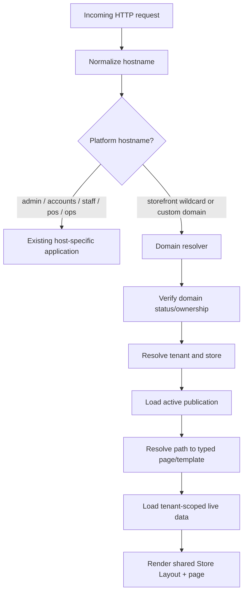
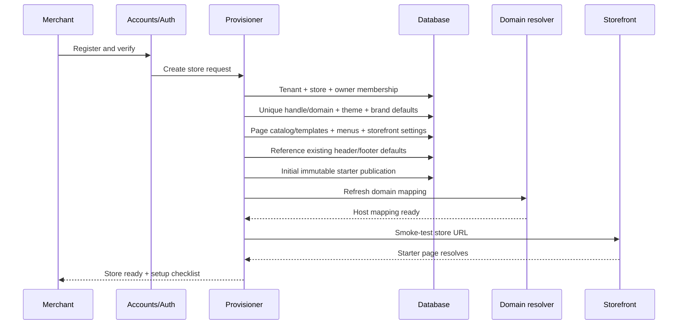

# 03 — Store Registration, Tenant Provisioning and Domain Routing

## 1. Multi-tenant model

Any eligible merchant can register, create an independent store and publish a customer website. Stores share application code and renderer, but each store has isolated data, branding, pages, themes, media, menus, domains, draft and publication versions.

Recommended default URL:

`{storeHandle}.stores.chandraprakash.codes`

Use the suffix already configured in the repository if it differs. Do not hardcode a second suffix or change the current routing setup blindly.

This should be one shared multi-tenant application and deployment. A separate deployment/project per merchant is unnecessary unless merchants later run arbitrary custom code or require isolated infrastructure.

## 2. Host routing

Rules:
- Normalize host (lowercase, strip valid port, handle IDNA where supported).
- Resolve host through a database-backed `StoreDomain` mapping. Do not derive tenant from arbitrary unchecked host text alone.
- Reject unknown, suspended, unverified or conflicting hosts safely.
- Never trust `X-Forwarded-Host` unless the proxy chain is explicitly trusted.
- Protect against Host header injection.
- Canonicalize aliases to the primary host with appropriate permanent redirect.
- Tenant-scope DB queries, cache keys, storage paths, analytics and event messages.
- Reserve platform hosts (`admin`, `accounts`, `staff`, `pos`, `ops`, `api`) from store handles.

## 3. DNS and deployment setup

Platform operations must configure a wildcard host such as `*.stores.chandraprakash.codes` to the shared storefront deployment using the hosting provider's supported wildcard-domain procedure. Verify wildcard certificate and routing before self-service registration is enabled.

This is a **platform-level prerequisite**, not something each merchant fixes. If missing, show a platform-operator warning and do not report every newly registered subdomain as live.

Default subdomain provisioning:
- Create a unique `StoreDomain` record for the default handle URL.
- Mark active only after platform wildcard DNS and HTTPS are ready.
- If wildcard routing is correctly configured, each merchant should not need an individual DNS record.
- Smoke-test host resolution before registration is declared complete.

Custom domain (optional):
- Merchant enters domain in Online Store → Settings → Domains.
- Validate syntax and ensure it is not already mapped to another tenant.
- Show exact DNS records from the hosting/domain provider; never invent target values.
- Verify ownership, configure mapping, wait for SSL, then allow as primary.
- Keep platform subdomain working while custom domain is pending.
- Show DNS/SSL status honestly; propagation is not necessarily immediate.

## 4. Registration/provisioning transaction

Use an idempotent provisioning workflow. A retry must not create duplicate stores/pages/menus/publications/domains. Use idempotency keys and DB uniqueness constraints. Core rows should be transactional; external DNS/certificate/cache operations need durable retryable jobs/outbox events.

## 5. Store capability modes

- `COMMERCE`: product catalogue, collections, cart, checkout, customer account, order status.
- `SERVICES`: service catalog, service detail, availability/booking, appointment confirmation and customer booking account.
- `HYBRID`: commerce and services together.

Mode configures which page groups/routes are provisioned. Switching mode later must not delete data; it enables/disables route availability and hides or archives unused presentation templates with a warning.

## 6. Initial starter experience

Create immediately:
- Store display identity defaults and clean brand fallback.
- Responsive default theme and initial version.
- Existing Header/Footer editor defaults linked once to common layout.
- Primary/footer menus with safe initial links.
- Homepage using new system-managed starter layout.
- Product listing, collection, product detail, search, cart and checkout routes for Commerce/Hybrid.
- Customer account routes.
- Contact/About/FAQ or equivalent content-page templates where enabled.
- Policy page templates/records with a “needs review” warning; do not invent final legal terms.
- 404 and maintenance/coming-soon pages.
- Service/booking pages for Services/Hybrid.
- SEO defaults, canonical host and immutable starter publication.

Never create fake products, prices, stock, reviews, orders or bookings. A new home page can show brand introduction, useful empty catalogue state or an actual featured collection if real records exist.

## 7. Separate lifecycle states

Store: `PROVISIONING` → `STARTER_READY` → `ACTIVE` → `SUSPENDED` / `CLOSED`.

Domain: `PENDING_PLATFORM` → `PENDING_VERIFICATION` → `PENDING_SSL` → `ACTIVE`; error states `DNS_INVALID`, `OWNERSHIP_CONFLICT`, `SSL_FAILED`, `SUSPENDED`.

Publication: `NO_PUBLICATION` → `PUBLISHING` → `PUBLISHED` or `PUBLISH_FAILED`.

A custom domain failure must not take down the default subdomain. A theme publish failure must not change domain status.

## 8. Public route resolution

- Resolve tenant by host first.
- Resolve path via typed system routes, then resource handle (product/collection/service/article), then custom page handle.
- Unknown paths return tenant-themed 404.
- Archived custom pages may redirect; otherwise 404.
- Custom pages cannot override required system routes.
- `robots.txt`, sitemap and canonical URLs are tenant-specific.
