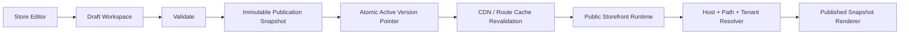

# 08 — Storefront Runtime, Draft/Live Publishing, Cache and Rollback

## 1. Separate editor state from public runtime

The editor is the authoring surface. The public tenant storefront is a runtime renderer. They share templates, global chrome, theme tokens and data-binding contracts, but customer requests must never read mutable draft state.

## 2. Save vs publish

- **Save Draft:** persists editable changes only.
- **Preview Draft:** renders current draft with scoped signed token.
- **Publish:** validates, snapshots and atomically activates a new version.
- **Rollback:** safely reactivates a prior successful immutable publication without deleting later versions.

Autosave must not silently publish. Publish is explicit and shows a summary/confirmation.

## 3. Publication snapshot

Snapshot or immutable references should include:
- Theme token version.
- Template/page presentation versions.
- Page visibility/SEO configuration.
- Navigation/menu versions.
- Header/Footer editor output version references.
- Storefront settings relevant to rendering.
- Media asset references using durable immutable IDs/URLs.
- Component/section schema compatibility manifest for future section support.
- Publication metadata and migration version.

Do not duplicate live Catalogue rows, orders or appointment availability into theme snapshots. Store stable references/query definitions and load current real tenant data through owning domain adapters unless a documented feature requires a versioned catalogue snapshot.

## 4. Atomic publish algorithm

1. User requests publish for a draft revision.
2. Acquire tenant/store publish lock or use compare-and-swap against expected version.
3. Validate routes, template compatibility, schemas, required protected controls, media, data bindings, navigation targets, domain state, SEO, policies and required store-mode setup.
4. Build immutable publication snapshot.
5. Commit snapshot and publication record.
6. Atomically switch `Store.activePublicationId` only if expected active version still matches.
7. Emit a durable tenant-scoped outbox event.
8. Invalidate/revalidate affected routes and domain cache keys.
9. Verify the new active snapshot can render homepage and required routes.
10. Mark successful and preserve previous active snapshot for rollback.

If any step before pointer switch fails, old live version stays active. If cache invalidation fails after switch, retry through outbox and surface actual state; do not fake success.

## 5. “Instant” update expectation

- Editor preview updates immediately from local state and saved draft.
- Public store changes only after Publish.
- Engineer for normal successful propagation within 5 seconds where hosting/cache allows; measure actual duration. This is an SLO target, not a universal zero-latency guarantee.
- Use versioned cache keys or explicit tag/path revalidation.
- Publishing one tenant must not mutate another tenant's content or unnecessarily invalidate all tenants.

## 6. Preview isolation

- Signed short-lived preview token scoped to tenant, store, user and draft revision.
- Public runtime ignores draft identifiers without a valid token.
- Do not expose draft content through predictable IDs.
- Token cannot alter host/tenant resolution.
- Preview route must be noindex and excluded from public sitemap.

## 7. Rollback/version history

- Keep immutable successful publication records.
- Retain configurable number of recent publications with explicit retention.
- Rollback creates a new activation event pointing at a known-good snapshot (or new rollback snapshot); it does not erase newer versions.
- Show publisher, date, version label/notes and validation result.
- Platform app deployments and merchant content publications are separate version domains. App deployment must never reset tenant content or publication pointers.

## 8. Caching and dynamic data

- Cache published page configuration/theme by tenant + publication version.
- Cache public assets by immutable content hash.
- Treat inventory, cart, account, checkout, personalized prices and booking availability as dynamic/private with correct cache policies.
- Never cache one customer's cart/account for another customer.
- Include tenant ID in every cache key.
- Catalogue product/collection updates revalidate affected storefront pages through domain events or revalidation, without requiring theme publish.
- Schedule changes revalidate availability. Do not freeze appointment availability inside theme version.

## 9. Failure handling

- Draft save failure: preserve local edits and retry.
- Draft conflict: show changed revision and offer safe reload/merge.
- Validation failure: show exact page/field and link to correct editor/Admin module.
- Publish failure: previous site remains live; store reason and retry state.
- Domain failure: default platform subdomain remains available.
- Missing page/template: tenant-themed 404 or safe fallback, never blank screen.
- Unknown component schema: block publish or use explicit verified repair fallback.
