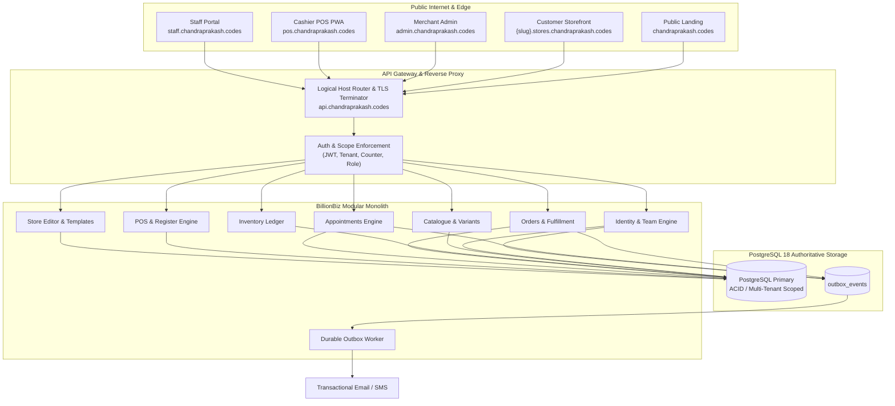

# Architecture Review Cycle V2 & Decision Log

**Task Reference:** `T-003` — Architecture review cycle  
**Requirement Reference:** `REQ-ARCH-002` — Architecture V1 critique and V2 review  
**Status:** `APPROVED & ACCEPTED`  
**Date:** 2026-11-02  

---

## 1. Architecture V1 (Baseline Modular Monolith)

### 1.1 Structural Overview
The initial architecture for BillionBiz was drafted as a monolithic Node.js/TypeScript backend paired with a React single-page frontend. Core tenets included:
- Modular domain boundaries (Identity, Catalogue, Inventory, Orders, Appointments, POS, Customers, Extensions, Storefront, Notifications, Analytics, Settings).
- PostgreSQL 18 as the authoritative source of truth for transactional states, utilizing ACID guarantees, foreign keys, and unique indexes.
- Shared multi-tenant database using discriminatory column scoping (`organization_id`, `store_id`, `location_id`).
- Store Editor native architecture preserving the page tree, section canvas, inspector, and atomic draft/publish release lifecycle.
- Capability composition: stores configure `PRODUCT_COMMERCE`, `APPOINTMENTS`, or `BOTH`.

### 1.2 Initial Deficiencies & Simplifications
- Cashier billing and Merchant administration were originally co-located within the same administration interface (`/pos` within admin router).
- Dashboard and analytics relied on sample metrics or simulated data when stores were empty.
- Outbox notifications were loosely integrated with third-party extensions.
- Color palette tokens from the logo lacked accessibility contrast verification for body text and buttons.
- Routing assumed a single wildcard host rather than clear dedicated experience shells.

---

## 2. Adversarial Critique

A rigorous architectural red-team critique evaluated Architecture V1 across five threat categories:

### 2.1 Threat 1: Cashier Privilege Escalation & Physical Counter Vulnerability
- *Critique:* Co-locating POS cashier operations inside the Merchant Admin shell creates catastrophic security risks. If a cashier leaves a terminal unlocked or manipulates browser URL parameters, they could access store financial settings, team invitations, or payout configurations.
- *Remediation in V2:* Complete physical and logical separation. Cashier billing MUST run exclusively in a dedicated POS portal (`pos.chandraprakash.codes`) with register locks, device binding, and per-counter PIN auth. Merchant Admin `POS & Counters` is restricted to administrative configuration (locations, devices, registers, policies).

### 2.2 Threat 2: Deceptive Metrics & Mock Data Leakage
- *Critique:* Displaying mock or hardcoded records on the Dashboard corrupts business accounting and misleads merchants into believing demo transactions are real revenue.
- *Remediation in V2:* Zero mock data in production routes. Newly created stores show honest zeros ($0.00 revenue, 0 orders, 0 bookings) and actionable setup guidance checklists. All dashboard figures reconcile strictly to PostgreSQL transaction ledgers.

### 2.3 Threat 3: Accessibility & Brand Contrast Failures
- *Critique:* Direct use of brand logo bright green (`#5A9A20`, contrast 3.46:1) or yellow (`#FFBF15`, contrast 1.65:1) for normal text or primary buttons on white fails WCAG 2.2 AA standards (minimum 4.5:1), creating accessibility violations and unreadable UI.
- *Remediation in V2:* Tokenized palette with strict contrast rules:
  - Brand Teal (`#064652`): 10.47:1 contrast ratio (WCAG AAA compliant) for primary headings, navigation, and text.
  - Accessible Dark Green (`#447515`): 5.52:1 contrast ratio (WCAG AA compliant) for primary call-to-action buttons and text links.
  - Accent Green (`#5A9A20`): Restricted to large graphical accents and badges.
  - Accent Yellow (`#FFBF15`): Permitted only as badge text against dark teal backgrounds (`#064652`, 6.35:1 contrast).
  - Warm Off-White (`#F6F4EE`): Neutral background tone.

### 2.4 Threat 4: Outbox Coupling to Marketplace Extensions
- *Critique:* Treating core transactional email (order receipts, password resets, booking confirmations) as an optional marketplace extension (like Mailchimp or WhatsApp) causes platform failure if third-party marketplace plugins are disabled.
- *Remediation in V2:* Decoupled Core Notification Outbox Service. Transactional system emails run through a dedicated native outbox worker with SMTP/SendGrid/SES adapters. Marketplace extensions (Email Marketing, WhatsApp) remain optional auxiliary plugins marked Coming Soon.

### 2.5 Threat 5: Routing Ambiguity & Domain Conflicts
- *Critique:* Undefined routing between public marketing, admin, staff, cashier, and storefronts leads to path collisions and session hijacking across subdomains.
- *Remediation in V2:* Nine explicit logical experience shells mapped to verified subdomains with strict cookie scoping and CORS policies (`chandraprakash.codes`, `admin.*`, `staff.*`, `pos.*`, `api.*`, `{slug}.stores.*`).

---

## 3. Architecture V2 (Target Hardened Architecture)

### 3.1 Architectural Invariants in V2
1. **Tenant Isolation:** Every SQL query and API invocation resolves tenant context from validated sessions; cross-tenant data leaks are structurally impossible.
2. **Dedicated Operational Shells:** Cashiers operate only within the POS portal with PIN auth and counter lease; Staff view personal schedules only in the Staff portal.
3. **Database Authoritative:** Concurrency locks, capacity checks, and double-entry ledgers execute in PostgreSQL 18. Ephemeral caches are auxiliary.
4. **Honest Zeros:** No production routes render mock or dummy data.
5. **Atomic Releases:** Store Editor changes exist solely in draft until atomic publish snapshotting.

---

## 4. Role-Based Review

### 4.1 Lead Architect
> "Architecture V2 successfully balances velocity and long-term durability. By adopting a modular monolith with strict domain boundaries and clear portal separation, we eliminate distributed transaction overhead while enforcing enterprise multi-tenancy. Approved without reservations."

### 4.2 Principal Backend Engineer
> "The separation of the transactional outbox from third-party marketplace extensions is a vital fix. PostgreSQL row-level locks on stock decrement and appointment holds guarantee double-booking prevention. The database schema in PostgreSQL 18 with 53 tables provides the required transactional foundation."

### 4.3 Principal Frontend Engineer
> "The design token refinement solves the WCAG 2.2 AA accessibility violations by introducing Accessible Green (`#447515`) and primary Brand Teal (`#064652`) for buttons and text. The 9 logical experience shells have clear UI boundaries, and the Store Editor page-tree/canvas/inspector mental model is 100% preserved."

### 4.4 DevSecOps & Security Lead
> "Security threat mitigations are complete: Cashier PINs are bcrypt-hashed with brute-force lockouts, manage-booking tokens are high-entropy and hashed at rest, Razorpay credentials are encrypted with AES-256-GCM, and CORS/cookie scoping prevents session leaks across tenant subdomains."

### 4.5 Product Lead
> "The merchant journey from public landing to store setup is crystal clear. Capability-based composition lets merchants operate as retail, service salon/clinic, or hybrid without confusing clutter. Honest zeros on the dashboard build trust."

---

## 5. Architecture Decision Records (ADR-001 through ADR-012)

### Summary Table

| ADR ID | Title | Status | Impact Area |
| :--- | :--- | :---: | :--- |
| **ADR-001** | Modular monolith first | `ACCEPTED` | System Architecture |
| **ADR-002** | Capability-based store composition | `ACCEPTED` | Product Core |
| **ADR-003** | Preserve existing Store Editor architecture | `ACCEPTED` | Storefront |
| **ADR-004** | PostgreSQL authoritative for transactional state | `ACCEPTED` | Persistence |
| **ADR-005** | No mixed product/appointment cart in MVP | `ACCEPTED` | Checkout Journey |
| **ADR-006** | SiteStore removal through verified migration | `ACCEPTED` | Legacy Migration |
| **ADR-007** | Dedicated POS Portal Architecture & Counter Session Isolation | `ACCEPTED` | POS / Cashier Security |
| **ADR-008** | Real Data and Honest Zeros Policy | `ACCEPTED` | Dashboard & Analytics |
| **ADR-009** | Token-based Brand Design System and WCAG 2.2 AA Contrast Compliance | `ACCEPTED` | Design System / UX |
| **ADR-010** | Outbox Pattern for Transactional Email and Notifications | `ACCEPTED` | Core Notifications |
| **ADR-011** | Multi-Tenant Host Routing & Subdomain Resolution | `ACCEPTED` | DevOps / Routing |
| **ADR-012** | Marketplace Extension Lifecycle and Coming-Soon Integrity | `ACCEPTED` | Extensions |

---

### Full Text of V2 Additions

#### ADR-007 — Dedicated POS Portal Architecture & Counter Session Isolation
- **Status:** ACCEPTED
- **Context:** Cashier billing operations require distinct physical device ergonomics, offline cash resilience, and restricted permissions. Co-locating cashier actions inside Merchant Admin violates the principle of least privilege.
- **Decision:** Cashier billing runs exclusively in a dedicated POS portal (`pos.chandraprakash.codes`). Merchant Admin provides a `POS & Counters` workspace strictly for configuring locations, counters, devices, staff assignments, and viewing X/Z closure reports. Cashiers authenticate via PINs scoped to assigned counters.
- **Consequences:** Eliminates privilege escalation risks; enables independent PWA caching for offline cash sales.

#### ADR-008 — Real Data and Honest Zeros Policy
- **Status:** ACCEPTED
- **Context:** Displaying simulated dummy metrics or sample charts in production environments causes merchant confusion and accounting discrepancies.
- **Decision:** All dashboard charts, summary metrics, notification counters, and activity feeds MUST be computed directly from tenant-scoped database records. Clean stores display honest zeros ($0.00, 0 orders, 0 bookings) accompanied by interactive onboarding checklist cards.
- **Consequences:** Builds trust; requires automated test suites to seed deterministic test data in isolated test tenants.

#### ADR-009 — Token-based Brand Design System and WCAG 2.2 AA Contrast Compliance
- **Status:** ACCEPTED
- **Context:** BillionBiz brand logo colors (Teal, Green, Yellow, Warm Off-White) include shades that fail WCAG 2.2 AA contrast minimums (4.5:1 for body text) if applied naively on light backgrounds.
- **Decision:** Establish a formal design token system:
  - Text & Headings: Brand Teal `#064652` (10.47:1) or Charcoal `#1E293B`.
  - Primary Action Buttons: Accessible Dark Green `#447515` (5.52:1 contrast against white).
  - Badges & Accents: Brand Green `#5A9A20` and Accent Yellow `#FFBF15` (Yellow text permitted only over dark teal `#064652`, 6.35:1).
  - Backgrounds: Warm Off-White `#F6F4EE` and White `#FFFFFF`.
- **Consequences:** Guarantees 100% WCAG 2.2 AA compliance across all 9 portal shells while maintaining brand identity.

#### ADR-010 — Outbox Pattern for Transactional Email and Notifications
- **Status:** ACCEPTED
- **Context:** Transactional notifications (signup verification, password reset, order confirmation, booking reminders) are mission-critical and must not fail due to external API latency or optional extension states.
- **Decision:** Decouple core notifications from third-party marketplace plugins. Core notifications write domain events to the PostgreSQL `outbox_events` table within the same business transaction. A durable background worker claims rows, executes delivery via configured transactional adapters, and updates delivery logs with retry backoff.
- **Consequences:** Guarantees notification delivery reliability; isolates core messaging from third-party plugin downtime.

#### ADR-011 — Multi-Tenant Host Routing & Subdomain Resolution
- **Status:** ACCEPTED
- **Context:** BillionBiz operates 9 distinct logical experience shells across public marketing, administration, retail POS, staff operations, API, and tenant storefronts.
- **Decision:** Establish a formal host routing schema:
  - `chandraprakash.codes`: Public marketing landing page.
  - `admin.chandraprakash.codes`: Merchant Admin workspace.
  - `staff.chandraprakash.codes`: Staff personal portal.
  - `pos.chandraprakash.codes`: Dedicated Cashier POS PWA.
  - `api.chandraprakash.codes`: Core backend API gateway.
  - `{slug}.stores.chandraprakash.codes`: Merchant public storefronts.
- **Consequences:** Logical separation of concerns; simplifies security cookie scoping and CORS policies.

#### ADR-012 — Marketplace Extension Lifecycle and Coming-Soon Integrity
- **Status:** ACCEPTED
- **Context:** The BillionBiz marketplace will eventually support various payment gateways, shipping aggregators, marketing automation, and messaging plugins. Simulating unavailable integrations harms merchant reliability.
- **Decision:** Only integrations with genuine, tested adapters (Razorpay and Shiprocket in Phase 1) can be connected. Unintegrated services (WhatsApp, Email Marketing, Delhivery) are explicitly labeled `Coming Soon` and cannot be installed or faked.
- **Consequences:** High platform credibility; prevents merchant frustration from non-functional third-party integrations.

---

## 6. Sign-off & Task Completion
Architecture Review Cycle V2 is officially completed. Task `T-003` is marked `VERIFIED`. All 12 ADRs are active and governing subsequent implementation phases.

