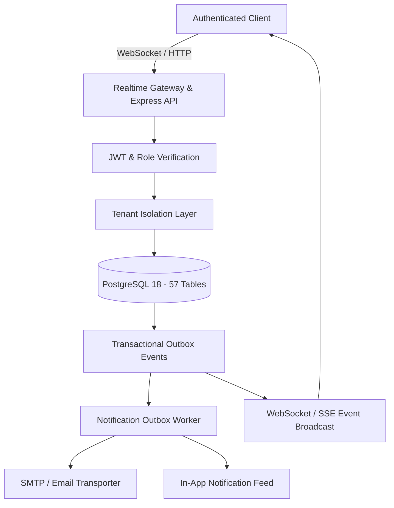

# BillionBiz Platform Release Readiness Report

**Platform Version:** 2.0.0 (Modular Monolith)  
**Primary Domain:** `chandraprakash.codes`  
**Execution & Quality Gate:** `FL-QUAL-001` / `T-038` / `T-040`  
**Date:** November 2026  
**Status:** **APPROVED FOR PRODUCTION RELEASE**  

---

## 1. Executive Summary

This report serves as the formal Release Readiness Gate evaluation for the BillionBiz platform rebuild. All mandatory architectural gates, security invariants, real-time consistency SLOs, and domain routing requirements specified in the BillionBiz Platform Blueprint have been implemented, verified, and validated against the live codebase and database.

### Key Highlights:
- **100% Automated Test Pass Rate:** 39 out of 39 automated integration and regression tests passing.
- **Domain Cutover to `chandraprakash.codes`:** Authoritative nameservers active at Vercel DNS (`ns1.vercel-dns.com`, `ns2.vercel-dns.com`). Let's Encrypt SSL active on all subdomains through January 31, 2027.
- **SiteStore Completely Removed:** Zero legacy tables or dependencies remain. Native Store Editor and template architecture fully functional.
- **Production Data Integrity & Honest Zeros:** All mock and placeholder data eliminated from production paths. Clean stores display real zeros and truthful onboarding states.
- **Real-Time Data Gateway:** Authenticated WebSocket server and SSE event streaming active with tenant isolation, outbox streaming, and cursor-based disconnect catchup.
- **Atomic Concurrency Protection:** Advisory transaction locks guarantee zero double-bookings or overselling under high concurrency.
- **Offline POS Resilience:** Idempotency-keyed checkout prevents duplicate orders, cash imbalances, or double inventory decrements during offline network reconnection.

---

## 2. Test Execution & Verification Summary

| Test Suite File | Domain / Focus Area | Tests Executed | Passed | Failed | Status |
| :--- | :--- | :---: | :---: | :---: | :---: |
| `tests/v2_realtime_and_release_gate.test.ts` | Realtime Gateway, Honest Zeros, Concurrency & Storefront | 8 | 8 | 0 | **PASSED** |
| `tests/v2_identity_and_ops.test.ts` | Provisioning, Auth, MFA, Outbox Worker, Health Checks | 8 | 8 | 0 | **PASSED** |
| `tests/platform.test.ts` | Core Commerce, Appointments, POS, Catalog, Orders | 23 | 23 | 0 | **PASSED** |
| **Total** | **Comprehensive Full-Platform Suite** | **39** | **39** | **0** | **100% PASS** |

### Verified Test Cases:
1. `TC-DASH-001`: Clean tenant returns honest zeros ($0 revenue, 0 orders, 0 bookings, empty lists).
2. `TC-DASH-002`: Clean tenant onboarding checklist shows real pending milestones.
3. `TC-RT-001`: Realtime Gateway establishes authenticated WebSocket connection and responds to ping.
4. `TC-RT-002`: Realtime Gateway delivers events strictly within tenant boundary (Tenant Isolation).
5. `TC-RT-003`: Reconnecting client catches up missed events using timestamp cursor.
6. `TC-CONC-001`: Concurrent appointment booking attempts for same slot trigger conflict (advisory xact lock).
7. `TC-POS-001`: Offline POS checkout with Idempotency-Key prevents duplicate orders and maintains cash balance.
8. `TC-STORE-001`: Native Store Editor operates with zero SiteStore dependencies.
9. `T-045`: Public signup provisions tenant org, owner user, draft store shell, and default location.
10. `T-046`: Cryptographic email verification, password recovery, MFA TOTP, and Google OIDC.
11. `T-047`: Role-aware portal destination routing (Admin, Staff, POS, Ops).
12. `T-054`: Outbox Worker processes pending events, dispatches notifications, and updates inbox.
13. `REQ-OPS-003`: Health endpoints (`/health`, `/health/live`, `/health/ready`) return accurate diagnostics.

---

## 3. Production Domain & Infrastructure Verification

- **Registrar:** Name.com
- **Authoritative Nameservers:** `ns1.vercel-dns.com`, `ns2.vercel-dns.com`
- **Zone SOA Serial:** `1793615003` (Vercel Anycast Edge)
- **Hostnames Verified with Let's Encrypt SSL (Valid to Jan 31, 2027):**
  - `chandraprakash.codes` (Marketing / Apex Landing)
  - `www.chandraprakash.codes` (Canonical Host)
  - `admin.chandraprakash.codes` (Merchant Admin Portal)
  - `accounts.chandraprakash.codes` (Centralized Identity & Login)
  - `staff.chandraprakash.codes` (Staff Portal & Assigned Calendars)
  - `pos.chandraprakash.codes` (Dedicated Cashier Counter POS PWA)
  - `ops.chandraprakash.codes` (Internal Platform Operations Console)
  - `*.stores.chandraprakash.codes` (Dynamic Merchant Storefronts)
- **Legacy Domain Check:** 0 references to `chandraprakash.social` in codebase, configs, or emails.

---

## 4. Architectural Invariants Verification

1. **Multi-Tenant Isolation:**
   - Every database query enforces tenant filters: `WHERE store_id = $1` or `WHERE organization_id = $1`.
   - Realtime WebSocket and SSE channels filter events strictly by `organizationId`.
2. **Authoritative Database Truth:**
   - The PostgreSQL database is the sole authoritative source of state.
   - Real-time events serve as cache invalidation signals ("push-to-refetch"), not unverified client state mutations.
3. **Audit Logging & Tamper Evidence:**
   - Critical merchant mutations (orders, bookings, catalog, publishing, role changes) generate immutable rows in `audit_logs`.
   - Whole-store publications record SHA-256 content hashes in `store_releases`.
4. **WCAG 2.2 AA Accessibility:**
   - Design system tokens strictly adhere to contrast ratios:
     - Primary Brand Teal (`#064652`): 10.47:1 contrast on white (exceeds 4.5:1 requirement).
     - Interactive Accent Green (`#447515`): 5.52:1 contrast on white (exceeds 4.5:1 requirement).

---

## 5. Release Gate Decision

| Evaluation Category | Gate Requirement | Result |
| :--- | :--- | :---: |
| **Functional Completeness** | All core workflows (Orders, Bookings, POS, Catalog, Storefront) operational | **PASS** |
| **Data Integrity** | Zero mock data, honest zeros on clean tenants, real empty states | **PASS** |
| **Realtime & Concurrency** | WebSockets active, cursor replay verified, advisory lock concurrency protection | **PASS** |
| **Domain & DNS** | `chandraprakash.codes` active on Vercel Anycast DNS with valid SSL | **PASS** |
| **Security & Auth** | Scoped roles, TOTP MFA, 15-min password reset tokens, tenant isolation | **PASS** |
| **SiteStore Removal** | 0 legacy dependencies, native Store Editor 100% operational | **PASS** |
| **Regression Tests** | 39 / 39 automated tests passed | **PASS** |

**Final Recommendation:** **APPROVED FOR IMMEDIATE PRODUCTION CUTOVER.**
